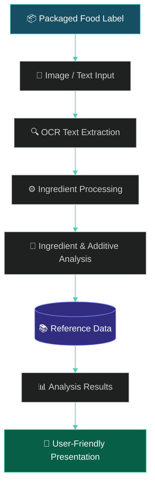

# 🥗 Packaged Food Analyser

<p align="center">
  
</p>

<p align="center">
  
</p>

<p align="center">
  
  
  
  
</p>

<p align="center">
  <b>📸 Scan.</b> &nbsp;→&nbsp; <b>🔍 Analyse.</b> &nbsp;→&nbsp; <b>📊 Understand.</b>
</p>

---

## 🌱 About The Project

**Packaged Food Analyser** is a web-based application designed to simplify the interpretation of packaged food labels.

Food packaging contains valuable information about ingredients, additives and nutritional composition. However, unfamiliar ingredient names, technical terminology and lengthy ingredient lists often make this information difficult to understand.

Our solution combines **Optical Character Recognition (OCR)**, ingredient processing and structured food-additive reference data to transform label information into accessible nutritional insights.

The goal is simple:

> Make food-label interpretation easier, more accessible and understandable for everyday consumers.

---

## 🎯 Problem Statement

To develop a web-based system that simplifies the interpretation of packaged food labels by extracting ingredient information through Optical Character Recognition (OCR), analysing identified ingredients using structured reference data, and presenting relevant nutritional insights in an accessible and understandable format.

## ⚡ Core Objectives

| Objective | Description |
|:---|:---|
| 📸 Automated Extraction | Extract ingredient text from packaged food images. |
| 🧪 Ingredient Analysis | Identify and process unfamiliar ingredients and additives. |
| 📚 Reference Integration | Provide accessible information using structured reference data. |
| 🍎 Nutritional Awareness | Present calorie-related information. |
| 💻 Accessibility | Deliver results through a simple web interface. |

---

## ✨ Key Features

<p align="center">
  
</p>

| Feature | Description |
|:---|:---|
| 📷 Image-Based Input | Upload packaged food label images for analysis. |
| 🔍 OCR Extraction | Extract text using Tesseract OCR. |
| 🧪 Ingredient Processing | Process extracted ingredient information. |
| 📖 Additive Reference | Interpret ingredients using structured reference information. |
| 🍎 Nutritional Insights | Provide calorie-related information. |
| 🌐 Interactive Interface | Submit labels and view results through a web interface. |

---

## ⚙️ System Architecture

<p align="center">
  
</p>

The application follows a processing pipeline that converts packaged food label information into understandable results.



### 🔄 Processing Pipeline

1. **Image Input:** The user submits a packaged food label.
2. **OCR Extraction:** Tesseract converts image text into machine-readable content.
3. **Ingredient Processing:** Extracted text is organised into identifiable information.
4. **Reference Lookup:** Identified ingredients are checked against available reference data.
5. **Analysis:** Relevant ingredient and additive information is retrieved.
6. **Results:** The processed information is presented through the application interface.

---

## 🛠️ Technology Stack

<p align="center">
  
</p>

| Technology | Application |
|:---|:---|
| Python | Backend processing and application logic |
| Flask | Web application framework |
| Tesseract OCR | Optical Character Recognition |
| HTML5 | Frontend structure |
| CSS3 | Interface styling |
| JavaScript | Frontend interactions |
| Structured Reference Data | Ingredient and additive interpretation |

---

## 🚀 Getting Started

### Prerequisites

Make sure you have the following installed:

- Python 3.9 or later
- Tesseract OCR
- Git
- A modern web browser

### 1. Clone the Repository

```bash
git clone https://github.com/soul2209/packaged-food-analyser.git

cd packaged-food-analyser
```

### 2. Install Tesseract OCR

Download and install Tesseract OCR for your operating system.

🔗 [Tesseract OCR – Official Repository](https://github.com/tesseract-ocr/tesseract)

Ensure that the Tesseract executable is accessible to your application. Windows users may need to configure the executable path.

### 3. Install Dependencies

If the repository includes a `requirements.txt` file:

```bash
pip install -r requirements.txt
```

### 4. Launch the Application

```bash
python app.py
```

Open the local address displayed in your terminal using your web browser.

---

## 🔬 Project Significance

Food labels are an important source of information about the products consumers purchase.

However, understanding the information printed on packaging can be challenging due to:

- Long and complicated ingredient lists.
- Unfamiliar additive names and codes.
- Technical nutritional terminology.
- Difficulty accessing relevant ingredient information.

Packaged Food Analyser explores how OCR and structured reference data can make food-label interpretation more accessible.

By reducing the effort involved in reading and understanding food labels, the project aims to support better nutritional awareness and informed consumer decisions.

---

## 🔮 Future Scope

The project provides a foundation for several potential enhancements.

| Enhancement | Proposed Development |
|:---|:---|
| 🌏 Regional Language Support | Extend OCR and reference data to Hindi, Marathi and other languages. |
| 🧬 Personalisation | Introduce user-specific dietary preferences and allergy profiles. |
| 📱 Mobile Application | Enable real-time camera-based food label scanning. |
| 📊 Advanced Analysis | Expand nutritional analysis and allergen identification. |
| 🧠 Improved OCR | Improve recognition of curved, blurry and low-resolution labels. |
| 📚 Database Expansion | Expand structured ingredient and additive reference information. |

---

## ⚠️ Disclaimer

This project is developed for educational and informational purposes.

OCR may produce inaccurate text, and ingredient interpretations depend on the available reference data. The results should not be considered medical advice or a guarantee of product safety.

---

## 👨‍💻 Project Author

<p align="center">
  
</p>

<p align="center">
  <a href="https://github.com/soul2209">
    
  </a>
  <a href="https://github.com/soul2209/packaged-food-analyser">
    
  </a>
</p>

---

<p align="center">
  
</p>

<p align="center">
  <b>🥗 Read the Label. Understand the Ingredients. Choose with Confidence.</b>
</p>

<p align="center">
  <sub>Built with curiosity, code and a little bit of science. 💚</sub>
</p>
