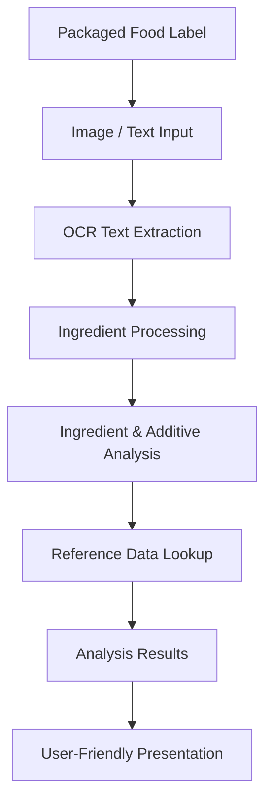

# 🥗 Packaged Food Analyser
### Understand What's Inside. Make Informed Choices.

**Packaged Food Analyser** is a web-based application designed to simplify the interpretation of packaged food labels. By combining Optical Character Recognition (OCR), ingredient analysis, and food-additive reference data, the system helps users understand ingredient lists and access relevant nutritional information.

---

## 📌 Problem Statement

To develop a web-based system that simplifies the interpretation of packaged food labels by extracting ingredient information through Optical Character Recognition (OCR), analysing identified ingredients using structured reference data, and presenting relevant nutritional insights in an accessible and understandable format.

## 🎯 Project Objectives

- Automate the extraction of ingredient text from packaged food label images.
- Reduce the difficulty of interpreting unfamiliar ingredient and additive names.
- Provide accessible information using structured food-additive reference data.
- Support nutritional awareness through calorie-related information.
- Present analysis results through a simple and user-friendly interface.

## ✨ Key Features

| Feature | Description |
|---|---|
| 📸 Image-Based Input | Upload packaged food label images for analysis. |
| 🔍 OCR Extraction | Uses Tesseract OCR to extract text from food labels. |
| 🧪 Ingredient Analysis | Processes extracted ingredient information to identify relevant components. |
| 📚 Additive Reference | Uses structured food-additive reference information to support interpretation. |
| 🍎 Nutritional Insights | Provides calorie-related information to support nutritional awareness. |
| 🌐 Interactive Interface | A web-based interface for submitting labels and viewing analysis results. |

## ⚙️ System Workflow

The application follows a pipeline that transforms packaged food label information into more understandable results.



## 🛠️ Technology Stack

| Technology | Purpose |
|---|---|
| Python | Backend processing and application logic |
| Flask | Web application framework |
| Tesseract OCR | Optical Character Recognition |
| HTML5 | Frontend structure |
| CSS3 | Interface styling |
| JavaScript | Frontend interactions |
| Structured Reference Data | Supporting ingredient and additive interpretation |

## 🚀 Getting Started

### Prerequisites

Ensure the following are installed:

- Python 3.9 or later
- Tesseract OCR
- Git
- A modern web browser

### 1. Clone the Repository

```bash
git clone https://github.com/soul2209/packaged-food-analyser.git
cd packaged-food-analyser
```

### 2. Install Tesseract OCR

Download and install Tesseract OCR for your operating system.

- [Tesseract OCR – Official Repository](https://github.com/tesseract-ocr/tesseract)

Make sure the Tesseract executable is accessible to the application. On Windows, configure its installation path if it is not automatically detected.

### 3. Install Python Dependencies

If a `requirements.txt` file is provided:

```bash
pip install -r requirements.txt
```

### 4. Run the Application

Navigate to the application directory and execute its Flask entry point:

```bash
python app.py
```

Open the local address displayed in the terminal in your web browser.

*Note: The application entry point and dependency requirements should match the files included in the repository.*

---

## 🎓 Project Significance

Food packaging contains important information about ingredients and nutritional composition. However, lengthy ingredient lists, unfamiliar additive names, and technical terminology can make this information difficult for consumers to interpret.

Packaged Food Analyser explores how OCR and structured reference data can make this information more accessible. By reducing the effort required to read and interpret food labels, the project aims to support greater food-label awareness and informed consumer decisions.

## 🔮 Future Scope

Potential improvements include:

- Improving OCR accuracy for curved, blurry, and low-resolution packaging.
- Expanding the ingredient and food-additive reference database.
- Enhancing nutritional analysis and allergen identification.
- Introducing more detailed explanations of identified ingredients.
- Improving mobile responsiveness and accessibility.
- Adding confidence indicators and references to trusted information sources.

## ⚠️ Disclaimer

This project is intended for educational and informational purposes. OCR may produce inaccurate text, and ingredient interpretations depend on the available reference data. The results should not be considered medical advice or a guarantee of product safety.

## 👨‍💻 Project Author

**Dawn Dsouza**

- GitHub: [@soul2209](https://github.com/soul2209)
- Project: [Packaged Food Analyser](https://github.com/soul2209/packaged-food-analyser)

---

<p align="center">

**Read the Label. Understand the Ingredients. Choose with Confidence.** 🥗

</p>
